# Security Deposit Register — AICTE FDR prototype

A local, synthetic-data prototype of an AICTE security-deposit / FDR management portal,
built from the supplied `memory/PDR.md`, `architecture.md` and `plan.md`.

It demonstrates the full P0 loop: institution submission, private evidence, mock extraction
with field-level provenance, explainable consistency findings, correction and resubmission,
manual/simulated verification, date-derived maturity alerts, an illustrative release checklist,
an authorized decision, and an append-only audit trail.

> **Not a live system.** No real institution, person, FDR or bank data is used. There is no
> live AICTE/bank/identity/payment integration. Approval is an administrative record only: it
> does not send a bank instruction, confirm lien status, or move funds. Regulatory
> interpretations remain `PENDING_CONFIRMATION`.

## Stack

| Layer | Choice |
|---|---|
| App | Next.js 15 (App Router) + React 19 + TypeScript (strict) |
| Data | Prisma + **SQLite** (local demo database) |
| Styling | Tailwind CSS v4 + a small ledger-inspired design system in `globals.css` |
| Auth | Opaque session cookie, SHA-256 token hash in the DB, scrypt password hashes |
| Files | Private local storage outside `public/`, SHA-256 per document version |
| Adapters | Deterministic mock OCR, simulated bank verification, in-app notifications |
| Tests | Vitest (33 tests: pure rules + integration trust boundaries) |

### Why SQLite instead of PostgreSQL

`PDR.md` proposes PostgreSQL (assumption ASM-005). This machine has no PostgreSQL server and no
Docker, so the smallest safe local implementation uses Prisma with SQLite while preserving the
modelled invariants: UUIDs, fixed-precision decimal money, date-only maturity semantics,
timezone-aware event timestamps, foreign keys, insert-only evidence and server-side tenant
scoping. Switching to PostgreSQL is a datasource/provider change plus migrations; no domain
logic depends on SQLite. See `memory/DECISIONS.md` (DEC-007).

## Run locally

```bash
npm install
cp .env.example .env          # then replace SESSION_SECRET with a long random value
npm run db:push               # create the local SQLite schema
npm run seed                  # deterministic synthetic demo data (resets the demo DB)
npm run dev                   # http://localhost:3000
npm run reset                 # anytime: recreate schema + wipe and reseed the demo DB
```

Generate a session secret:

```bash
node -e "console.log(require('crypto').randomBytes(32).toString('hex'))"
```

### Demo accounts

Every seeded account uses the password **`Demo@1234`**.

| Account | Role | Use it to |
|---|---|---|
| `admin@sunrise.demo` | Institution Admin | Create/upload/submit, respond to corrections, open cases |
| `viewer@sunrise.demo` | Institution Viewer | Read-only own-institution access |
| `admin@lakeview.demo` | Institution Admin (other tenant) | Demonstrate isolation |
| `officer@aicte.demo` | Scrutiny Officer | Queue, findings, correction requests, verification |
| `reviewer@aicte.demo` | Departmental Reviewer | Clearances and checklist tasks |
| `authority@aicte.demo` | Competent Authority | Critical overrides, case decisions, closure |
| `auditor@aicte.demo` | Auditor | Read-only audit trail and chain verification |
| `sysadmin@aicte.demo` | System Admin | Source register, demo clock, audit |

## Demo script (about 5 minutes)

1. Sign in as **institution admin**. Open `SYN-FDR-100247` (a draft) or create a new record.
2. Upload a PDF/JPG/PNG (≤ 10 MB). The server checks type, size, magic bytes and extension;
   it stores the file privately and records a SHA-256 digest and document version.
3. Run **mock extraction**, then review the extracted fields side-by-side with the document.
   Confidence chips are extraction confidence, not authenticity.
4. Correct a field (e.g. the amount) and confirm. Both the OCR value and the confirmed value
   are retained with provenance.
5. Submit for scrutiny. Deterministic checks run. Open `SYN-FDR-100245` to see extraction
   differences, or `SYN-FDR-100244` to see a critical date finding and a correction request.
6. Sign in as **officer**. Take a submitted record into review, request a correction, resolve
   non-critical findings, or record a **simulated** / **manual** verification outcome.
   A critical finding blocks ordinary verification; the authority can override it with a reason.
7. Sign in as **institution admin** after a correction request: upload a new document version
   (the old one remains), re-extract, confirm and resubmit.
8. Sign in as **officer** and open **Maturity alerts**. Freeze the demo clock, run the scan,
   run it again (idempotent), then acknowledge an alert.
9. Open a release case from an active record (or use the seeded open case). The checklist is
   labelled **ILLUSTRATIVE SAMPLE — not an official AICTE sequence**.
10. Sign in as **reviewer**: record a PGRC/Vigilance clearance and complete the assigned tasks.
11. Sign in as **officer**: complete the scrutiny checklist items.
12. Sign in as **authority**: approval stays blocked until every required item is satisfied;
    then record a decision with a reason. The instrument lifecycle does not change.
13. Sign in as **auditor**: inspect the audit trail and its verified hash chain.

### Seeded scenario pack

- Active primary FDR with a simulated verification, plus an open, partly-reviewed release case.
- Maturing in 25 days; matured 10 days ago (lifecycle deliberately still `ACTIVE`).
- Correction requested with a critical date finding.
- Submitted record with mock extraction differences and low confidence.
- Document whose filename contains `ocrfail` to exercise the manual-entry fallback.
- Draft with no document; duplicate bank+FDR number across two institutions.
- Approved refund case whose instrument is still `ACTIVE` (to demonstrate separation of case
  and instrument lifecycle, and explicit closure).

## Commands

| Command | Purpose |
|---|---|
| `npm run dev` | Development server |
| `npm run build` | Prisma generate + production build |
| `npm start` | Serve the production build |
| `npm run typecheck` | `tsc --noEmit` |
| `npm run lint` | ESLint (next/core-web-vitals + typescript) |
| `npm test` | Recreate the test DB, run Vitest (33 tests) |
| `npm run db:push` | Apply the Prisma schema to the local DB |
| `npm run seed` | Reset and reseed synthetic data |
| `npm run reset` | `db:push` + seed: deterministic demo reset (demo DB only) |

ESLint runs through `eslint.config.mjs` (next/core-web-vitals + typescript) and passes with zero
errors; TypeScript strict mode and the Vitest suite are the other executable checks.

## Where things live

```
src/app/(portal)/            Role-aware pages: dashboard, records, review, queue, cases,
                             alerts, audit, source register
src/app/api/                 HTTP boundary: auth, instruments, documents, extraction,
                             findings, verification, cases, alerts, audit verify, demo clock
src/lib/services/            Domain transitions + authorization + atomic audit
src/lib/rules/               Discrepancy engine, illustrative checklist, rule source seeds
src/lib/adapters/            Mock OCR and simulated bank verification
src/lib/rbac.ts              Server-side role and tenant scopes
src/lib/audit.ts             Hash-chained audit inside the business transaction
prisma/schema.prisma         Data model
prisma/seed.ts               Deterministic synthetic fixtures
tests/                       Pure rules + integration trust-boundary tests
```

## Trust boundaries enforced in code

- Institution scope comes from the authenticated session, never from a request body.
- A document hash proves byte integrity only; extraction never verifies authenticity.
- `SIMULATED` results are persisted as `SIMULATED_RESULT` with `simulated=true` and shown as
  “Simulation only”. Manual review is `MANUAL_REVIEW_RECORDED`, not bank confirmation.
- Critical findings block ordinary verification and release approval; an authority override
  requires a reason and preserves the finding.
- A business mutation and its audit event commit in one transaction. An audit insert failure
  rolls the mutation back (tested with a foreign-key failure).
- Case status never silently rewrites instrument lifecycle; maturity buckets are date-derived.
- No active approved rule version exists; amount/term guidance is disabled and returns
  `RULES_PENDING` / review-required behaviour instead of invented conclusions.

## Environment

See `.env.example`. Key variables: `DATABASE_URL`, `SESSION_SECRET`, `FILE_STORE_PATH`,
`OCR_ADAPTER=mock`, `BANK_ADAPTER=simulated`, `NOTIFY_ADAPTER=inapp`, `DEMO_MODE`,
`TEST_CLOCK_ENABLED`. Do not commit `.env` or real data.

## Known limitations

See `memory/KNOWN_LIMITATIONS.md` for the full list, including: SQLite instead of PostgreSQL,
no production identity/security review, mock OCR, no live bank interface, in-app only
notifications, no email/CSV/interest ledger/workflow editor, no external timestamping, and
unconfirmed regulatory applicability.

## Screenshots

Captured from the running app against the seeded demo data (`screenshots/`).

| Screen | View |
|---|---|
| Sign in (desktop) | 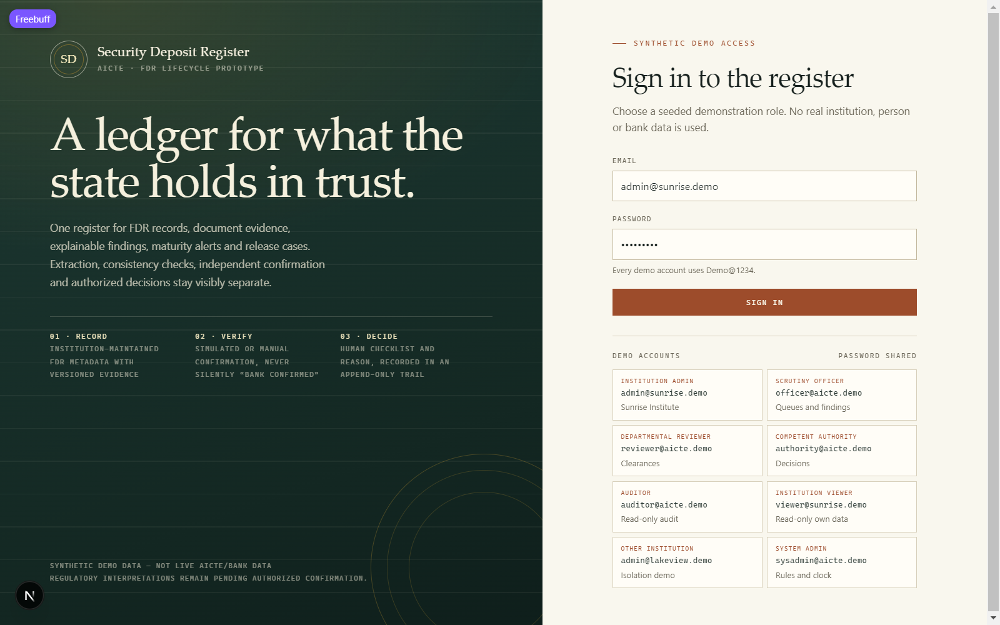 |
| Dashboard, institution admin (desktop) | 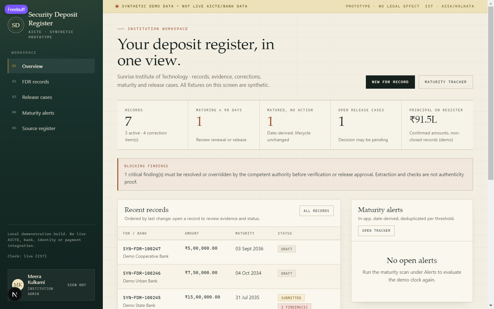 |
| FDR records list | 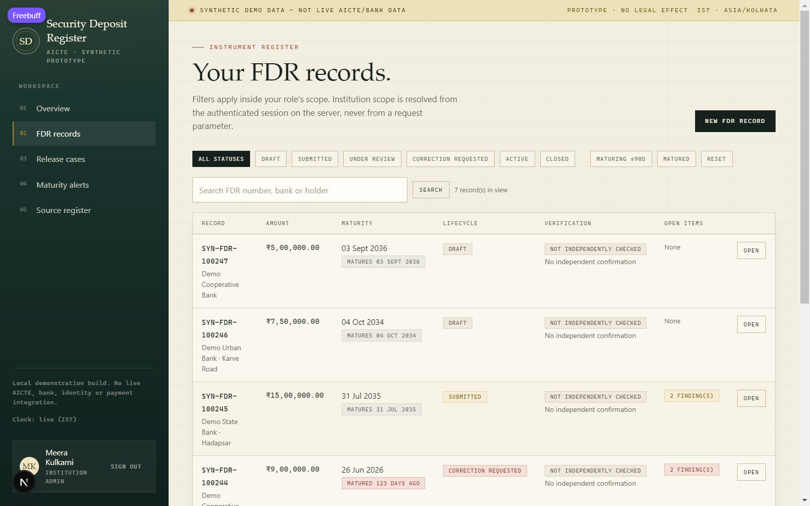 |
| Instrument detail | 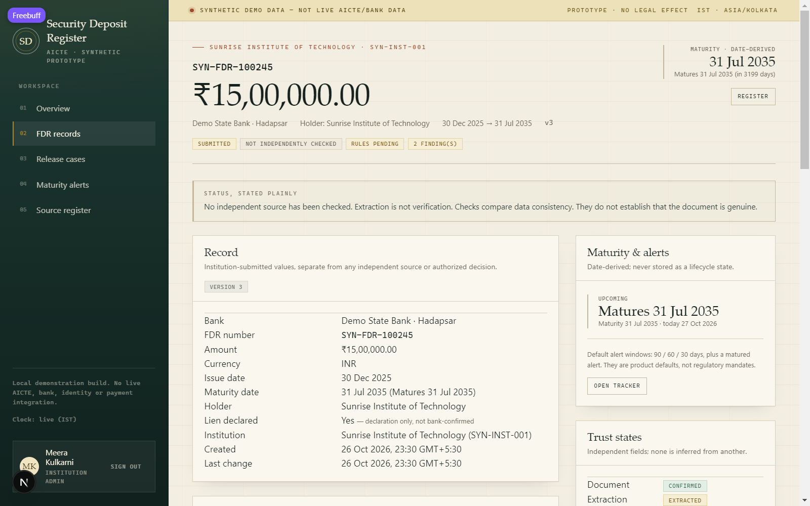 |
| Field review with extraction-failure fallback | 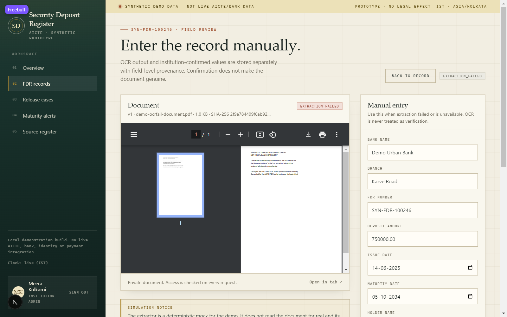 |
| Maturity alerts | 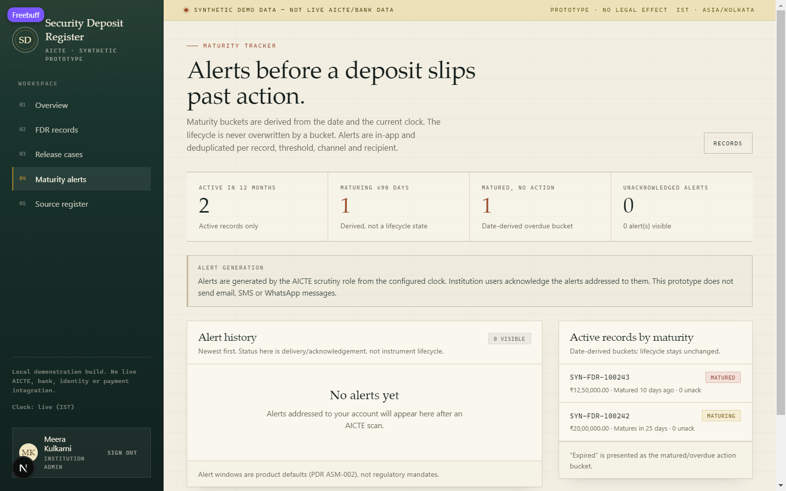 |
| Release cases | 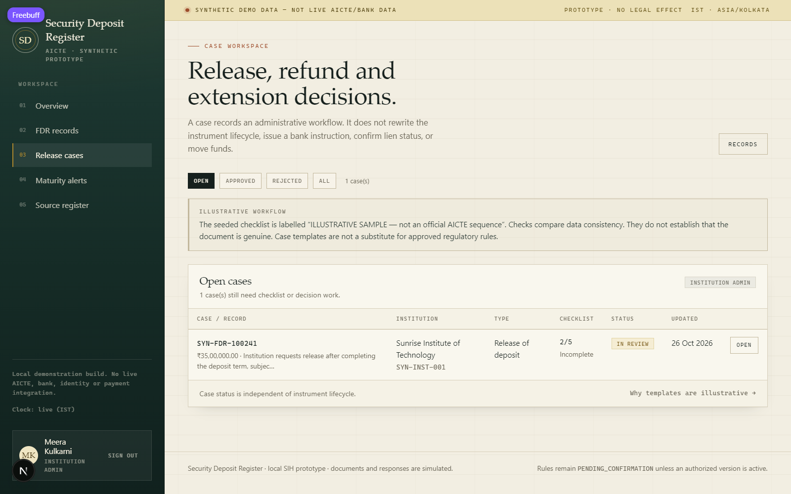 |
| Audit trail with verified hash chain | 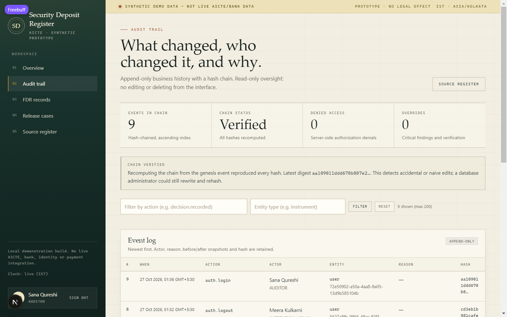 |

Responsive pass (tablet portrait 768 px and phone 414 px):

| Tablet dashboard | Tablet detail | Phone dashboard |
|---|---|---|
| 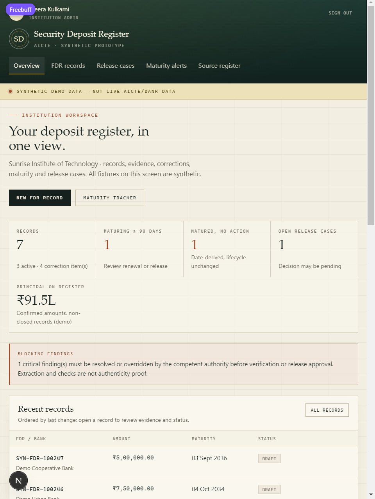 | 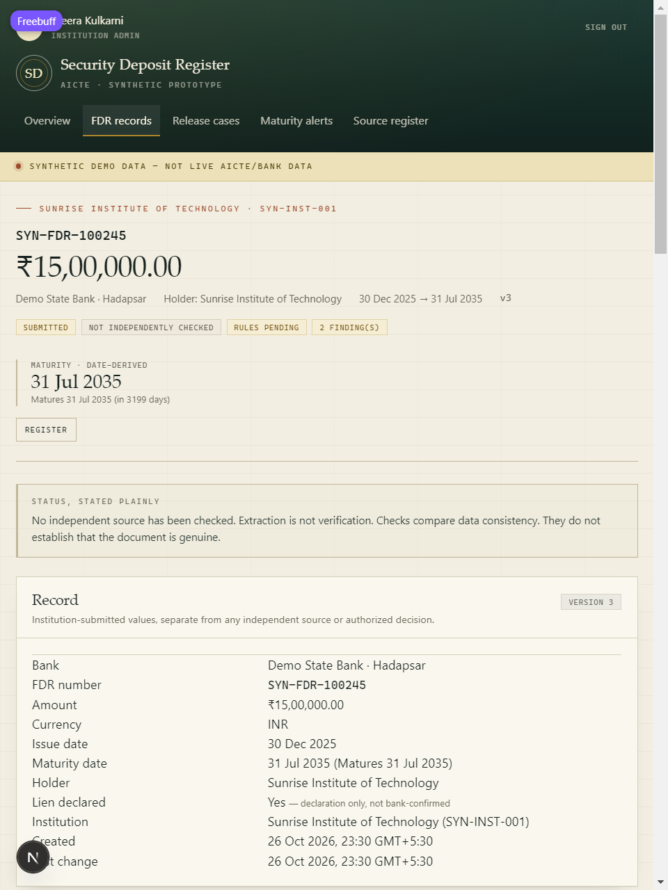 | 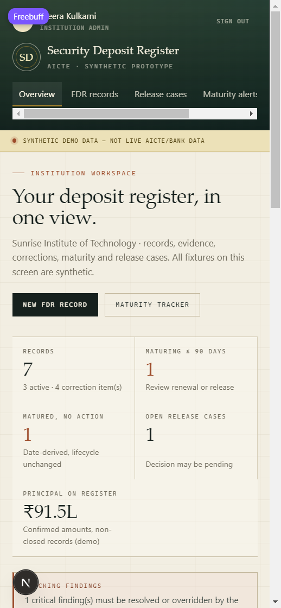 |

| Tablet login | 404 state |
|---|---|
| 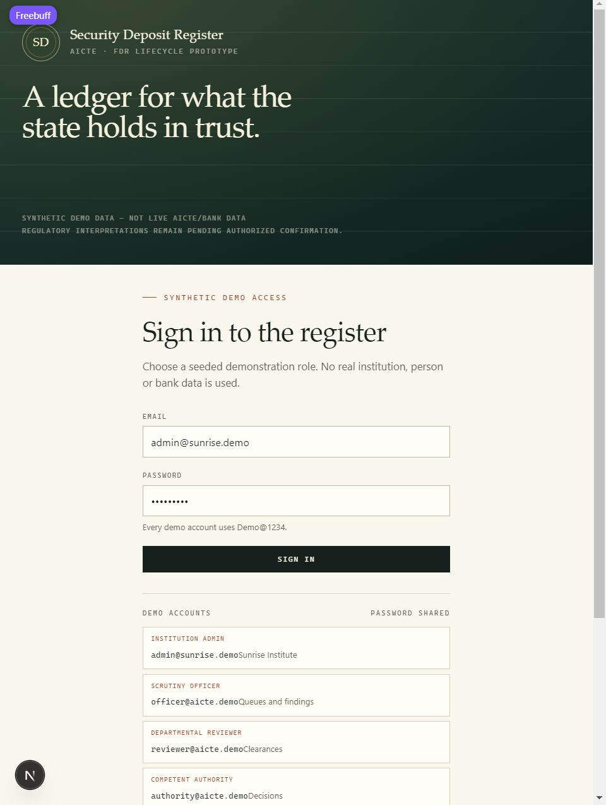 | 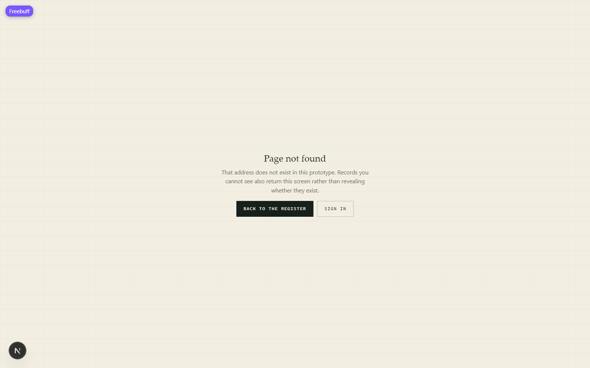 |
