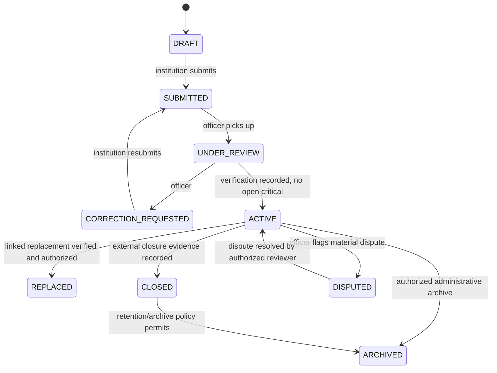
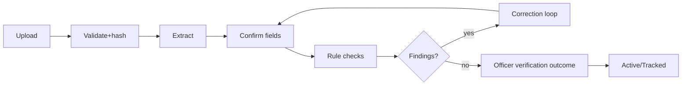
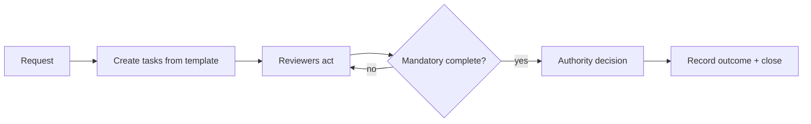
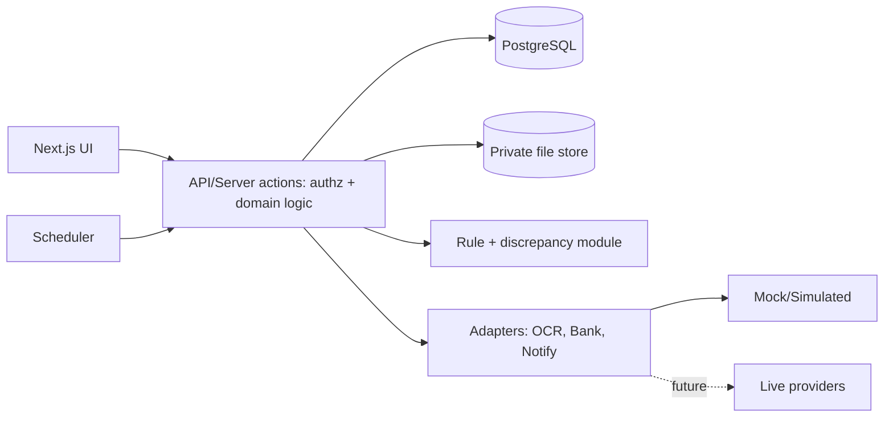
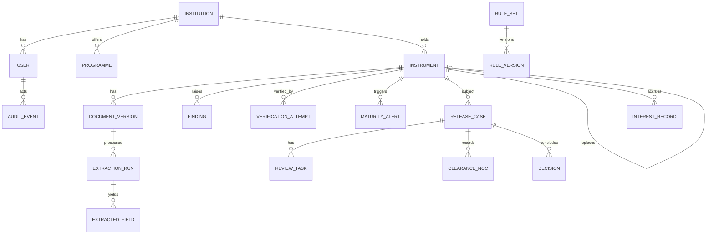
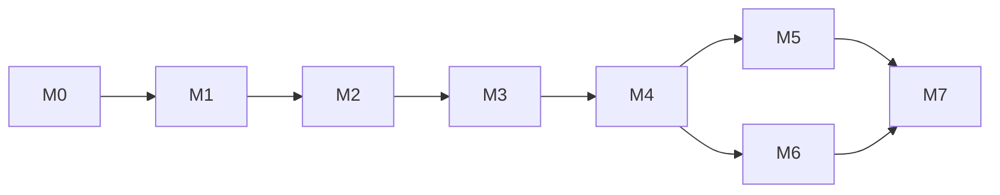

# PDR: AICTE Security Deposit / FDR Management Portal (SIH Prototype)

**Version:** 1.0 | **Date:** 26 Oct 2026 | **Status:** Implementation-ready prototype specification (regulatory sign-off still required)

> **Evidence and regulatory-safety notice.** This version uses the supplied SIH problem statement and publicly accessible **AICTE Approval Process Handbook 2024–2027** for an initial source map: Clause 1.12 / Table 1.4 (printed page 10) covers security-deposit categories, amounts, private leased land/building, ten-year term, interest treatment, extension and forfeiture; Clause 6.46 (printed page 61–62) covers release of Security Deposit, required documents, clearances and special cases. Reference copy: [Approval Process Handbook 2024–2027 PDF](https://www.iiqaccreditation.com/public/assets/aicte-process-handbook-2025-26.pdf); the official AICTE-hosted copy is listed at [AICTE](https://www.aicte.gov.in/sites/default/files/APH%20Final.pdf). **This is not legal sign-off**: before treating any rule as active, the team must confirm that this is the applicable edition, check later amendments/circulars and have an authorized stakeholder validate the rule interpretation. The portal must store the source, clause, page, effective dates, interpretation, approver and version for every active rule. Any unconfirmed rule remains `PENDING_CONFIRMATION` and must not silently block, approve, or calculate an official decision.

---

## 1. Executive Summary

**Problem.** AICTE tracks security deposits/FDRs of technical institutions across fragmented records. Officials struggle to see current status, maturity, pending actions and release progress.

**Solution.** A web portal with three pillars: (A) Institution Portal, (B) AICTE Administrative Engine, (C) Bank Verification Bridge. It centralizes records, assists extraction (OCR), runs explainable consistency checks, tracks maturity/renewal, and manages release cases through a configurable checklist, with full audit history.

**Primary users:** institution admins, AICTE scrutiny officers, reviewers, approving authorities, auditors.

**Distinguishing capabilities:** strict separation of *document extraction*, *consistency checks*, *regulatory rule evaluation*, *bank/source confirmation* and *authorized administrative decision*; field-level provenance; versioned rules; and visible labelling of simulated data. OCR confidence is not a fraud score. A hash proves byte integrity after upload, not that the FDR is genuine.

**Prototype boundaries.** Synthetic data only; simulated bank responses; mock notifications; no real bank/AICTE/identity integration; portal approval never equals a bank instruction.

**Measurable outcomes (baseline-dependent).** Reviewer minutes per instrument, % records with complete mandatory fields, % maturities alerted before threshold, case age visibility. Baselines must be measured with AICTE/stakeholders; no current-performance figure is asserted here.

## 2. Problem Definition and Current-State

| ID | Statement | Category |
|---|---|---|
| PS-001 | Maintain institution- and instrument-wise records (ref no., bank, amount, issue/maturity date, validity, documents, status) | Problem-statement |
| PS-002 | Digital submission/storage of FDR documents | Problem-statement |
| PS-003 | Distinguish institution-submitted info from info confirmed by authorized bank/financial source | Problem-statement |
| PS-004 | Track maturity/validity; configurable reminders; flag overdue | Problem-statement |
| PS-005 | Track renewal/replacement with history | Problem-statement |
| PS-006 | Record release/discharge/refund requests subject to regulations and competent authority | Problem-statement |
| PS-007 | Dashboard: active, expiring, matured, renewed, released, pending | Problem-statement |
| PS-008 | RBAC, encryption, audit trail; integration only where feasible and authorized | Problem-statement |
| PS-009 | Checklist: required documents, clearances, outstanding conditions, responsible authority | Problem-statement (compliance checklist note) |
| PS-010 | Decision history preserving evidence of extensions, release, forfeiture, NOCs, corrections | Problem-statement (team note) |
| OBS-001 | Officials manually compare uploaded PDFs to bank evidence; slow, forgery-prone | Stakeholder-reported, unverified |
| OBS-002 | Lien may not be marked / FDR may be broken early; no real-time trigger | Stakeholder-reported, unverified |
| OBS-003 | 10,000+ colleges, rolling 8-10 year window; NOC routing (Vigilance, PGRC) via manual file movement | Stakeholder-reported, unverified (scale, window and department names unconfirmed) |
| OBS-004 | Interest routing (AICTE vs scholarship funds) lacks a ledger | Stakeholder-reported, unverified |

**Future state:** one repository, assisted capture, explained findings, scheduled alerts, case workflow, audit trail.

## 3. Objectives, Non-Goals, Metrics

**Objectives:** O1 end-to-end lifecycle demo; O2 every finding explainable; O3 zero silent "verified"; O4 full audit; O5 configurable rules/workflows.

**Non-goals:** live bank integration; moving real money; legal validity of generated documents; Aadhaar/PAN/e-sign/e-stamp; national analytics; blockchain; ML fraud detection.

| Metric | Definition | Measurement | Target |
|---|---|---|---|
| Field completeness | Instruments with all mandatory fields / total | DB query | Baseline first; prototype demo 100% on fixtures |
| Review time | Submit → verification outcome recorded | Timestamps | Compare to measured manual baseline |
| Alert timeliness | Maturities with alert sent ≥ threshold days prior | Alert table | 100% in simulated-clock tests |
| Finding explainability | Findings with all explanation fields | Test | 100% |
| Audit coverage | State changes with audit event | Test | 100% |

## 4. Stakeholders and Personas

Role names are **proposed**, not official AICTE designations.

| Persona | Responsibilities | Permitted actions | Info needs | Primary risk |
|---|---|---|---|---|
| Institution Admin | Submit/maintain own instruments | Create instrument, upload, confirm fields, respond to corrections, request release | Own status, deadlines | Wrong data, missed deadline |
| Institution Viewer (P1) | Read own records | View | Own status | Leakage |
| Scrutiny Officer | First review | Review queue, raise findings, request correction, record verification outcome | Evidence, provenance | Missing forgery, bias |
| Departmental Reviewer | Configured clearance step | Complete assigned review task, record NOC/clearance | Case file | Delay |
| Competent Authority | Decide | Approve/reject/return/escalate | Full case + history | Wrongful decision |
| Auditor | Oversight | Read-only incl. audit log | All histories | Over-broad access |
| System Admin | Config, users | Manage users, rule/workflow config (two-person approval for rule publish) | Config | Privilege abuse |
| Integration Service Account | Adapter calls | Write integration results only | n/a | Credential compromise |

## 5. Scope and Prioritization

| Tier | Items | Why |
|---|---|---|
| **P0 — must work end-to-end** | Demo login and server-side RBAC; institution isolation; institution/instrument CRUD; safe private document upload + version history; mock extraction + manual confirmation; deterministic checks with explainable findings; correction/resubmission loop; manual/simulated verification clearly distinguished; maturity status derived from dates + in-app alert simulation; basic release case with explicitly illustrative checklist; authorized decision recording; audit trail; dashboard; seeded synthetic data; automated tests for critical flows | Build one reliable vertical slice before optional features. This is the judging/demo baseline. |
| **P1 — add only after P0 passes** | Replacement/re-newal linking; configurable workflow template UI; escalation; email mock; CSV exports; advanced fuzzy duplicate candidates; production OCR adapter; interest records as bank-reported/estimate only | Adds value, but must not delay a coherent P0. |
| **P2 — explicitly out of prototype** | Live bank verification; actual lien status; real AICTE integration; SMS/WhatsApp; e-sign; real fund transfer; production rule publishing; external timestamping | Requires authorized interfaces, agreements, credentials, security and operational approval. |

## 6. Regulatory and Source Requirements Register

| Source ID | Title | Authority | Edition/date | Clause/page | Establishes | Limits | Type | Access |
|---|---|---|---|---|---|---|---|---|
| SRC-001 | SIH problem statement (Security Deposit/FDR Management Portal) | SIH/AICTE (as supplied) | Not stated | n/a | PS-001..PS-008 | No regulatory detail | Primary (for requirements of the challenge) | Supplied text |
| SRC-002 | Team notes (compliance checklist, rule matrix, pain points) | Team | 24/10/2026 chat | n/a | PS-009/010, OBS-001..004 | Unverified | Team-provided | Supplied text |
| SRC-003 | AICTE Approval Process Handbook 2024–2027 | AICTE | 2024–25 to 2026–27 | Clause 1.12, Table 1.4, printed p. 10; Clause 6.46, printed pp. 61–62 | Deposit amount table, specified applicability/exemption cases, term/interest/extension/forfeiture, release procedure and clearances | Edition applicability and any later amendments must be confirmed; handbook provisions may differ by institution/programme context | Primary regulatory source (public copy) | Reviewed online 26 Oct 2026; stakeholder sign-off pending |
| SRC-004 | Later AICTE circulars/amendments and applicable LoA/LoI/approval records | AICTE / competent authority | To be established | Relevant clause/date | Whether handbook provisions are amended or case-specific requirements apply | Not yet exhaustively verified | Primary when obtained | Pending team/AICTE confirmation |

Initial source-derived rule topics from SRC-003 (still require applicable-edition and stakeholder validation before activation):

| ID | Topic (team note wording, paraphrased) | Status |
|---|---|---|
| REG-001 | Table 1.4 lists deposit amounts by programme and level; note says amount is double for private leased building/land | SOURCE_FOUND; applicability/interpretation review required |
| REG-002 | Clause 1.12(i) describes an exemption for a specified category of existing institutions | SOURCE_FOUND; exact eligibility and cross-clause applicability require review |
| REG-003 | Clause 1.12(iv) says deposit remains with Council for 10 years; Affidavit 6 also references 8/10-year cases | SOURCE_FOUND; do not hard-code one duration across all records; confirm applicable case |
| REG-004 | Clause 1.12(v) allows extension case-by-case | SOURCE_FOUND; decision must be human-authorized |
| REG-005 | Clause 1.12(v) addresses return of principal at term completion | SOURCE_FOUND; release eligibility and supporting conditions require review |
| REG-006 | Clause 1.12(v) mentions possible forfeiture under specified circumstances | SOURCE_FOUND; never automate forfeiture |
| REG-007 | Clause 6.46 sets release documents and clearance requirements, including PGRC, Vigilance and other relevant cells/bureaus; it describes NOC for FDR/RPGF and sanction order for RTGS | SOURCE_FOUND; case-specific applicability and current process require review |
| REG-008 | Clause 6.46 includes special conditions for financial embezzlement-related NOC, conversion to private university/deemed university, progressive closure and merger | SOURCE_FOUND; encode as case types/checklists only after stakeholder validation |

Assumptions: ASM-001 rules stored as versioned config; ASM-002 alert windows 90/60/30 days are product defaults, not regulatory mandates; ASM-003 review-stage order is a configurable template and is not represented as an official routing sequence until approved; ASM-004 all bank verification is manual or simulated in the prototype; ASM-005 stack choice (Section 19); ASM-006 prototype dates use Asia/Kolkata for display and scheduling; ASM-007 synthetic/demo records are visually and programmatically labelled. Rule activation requires source, clause, interpretation, effective dates, test cases and two-person approval.

## 7. Regulatory Requirements Matrix

The source handbook clauses are identified below, but the applicability/interpretation of each rule still requires confirmation by an authorized stakeholder. System behaviour is **safe-by-default**: show the source basis, record the applicable rule version, route uncertain cases to a human, and never auto-decide release, forfeiture, exemption or extension.

| Req ID | Source/clause | Rule | Applicability | Required system behaviour | Inputs/validation | Exception | Human approval | Test | Open question |
|---|---|---|---|---|---|---|---|---|---|
| REG-001 | SRC-003, Clause 1.12 / Table 1.4, p. 10 | Deposit amount by programme/level; private leased land/building note | Depends on institution category, programme/level and property circumstances | Apply only an approved, effective rule version; display calculation inputs and source. If applicability is unclear, mark `REVIEW_REQUIRED` and do not claim a definitive amount | institution category, programme, level, private leased property flag, rule version | Missing/ambiguous input → no automated conclusion | Authorized reviewer | AT-R01 | Q1, Q2 |
| REG-002 | SRC-003, Clause 1.12(i), p. 10 | Specified exemption for a defined category of existing institutions | Case-specific | Institution may claim exemption and upload evidence; route to authorized review; never auto-exempt from name/category alone | applicable category, regulatory history/evidence | Incomplete evidence → return for correction | Authority | AT-R02 | Q3 |
| REG-003 | SRC-003, Clause 1.12(iv), p. 10; Affidavit 6, p. 192 | Deposit term | Case-specific; source contains 10-year provision and affidavit wording referencing 8/10-year cases | Store term and term-basis source per instrument; only calculate expected end date when approved rule and start-date basis are present | deposit creation date, applicable term, rule version | Conflict/unknown basis → review flag | Officer/Authority per approved workflow | AT-R03 | Q4 |
| REG-004 | SRC-003, Clause 1.12(v), p. 10 | Case-by-case extension | Case-specific | Create extension case, evidence, reason and decision; update term only after authorized decision | request, evidence, prior term | No authority decision → no date change | Authority | AT-R04 | Q5 |
| REG-005 | SRC-003, Clause 6.46(a)–(d), pp. 61–62 | Release of FDR/RTGS and required documents/clearances | Release path differs for FDR/RPGF versus RTGS and special cases | Use versioned checklist mapped to source clauses; distinguish administrative NOC/sanction from bank execution; all mandatory tasks must be complete before decision | request letter, Affidavit 6, FDR/payment proof as applicable, latest LoA/EoA, required clearances | Missing required item → cannot approve | Authority | AT-R05 | Q6, Q7 |
| REG-006 | SRC-003, Clause 1.12(v), p. 10 | Possible forfeiture in specified circumstances | Case-specific | Capture evidence and rationale; no automated forfeiture or irreversible status change | evidence, findings, applicable clause | Any uncertainty → escalation | Authority only | AT-R06 | Q9 |
| REG-007 | SRC-003, Clause 1.12(iii) and Clause 6.46, pp. 10, 61–62 | Prior NOC and release requirements | Case-specific | Store NOC issuer, reference, issue date, scope, attached document and verification status; never infer NOC validity from upload alone | NOC record and document | Unverified/expired/out-of-scope NOC → review | Reviewer/Authority | AT-R07 | Q8 |
| REG-008 | SRC-003, Clause 6.46(e), (g)–(i), pp. 61–62 | Financial embezzlement NOC and special release cases | Applicable to specified case types | Route financial-embezzlement cases to required external NOC; add special checklist for conversion, progressive closure and merger only when applicable; no auto-release | case type, evidence, clearance status | Any required clearance missing → decision blocked | Authority | AT-R08 | Q10, Q11, Q15 |

## 8. Functional Requirements Catalogue

Common audit rule: every state change writes an `audit_event` (actor, action, entity, before/after, timestamp, reason). Failure behaviour: reject with typed error, no partial state change.

| ID | Pri | Actor | Requirement (behaviour / state change) | Preconditions | Failure | Test |
|---|---|---|---|---|---|---|
| FR-001 | P0 | All | Login, session, role-aware landing | Active user | Lockout after N failures | AT-F01 |
| FR-002 | P0 | Admin | Create institution + programme profile; user linked to one institution | System admin | Duplicate AICTE ID rejected | AT-F02 |
| FR-003 | P0 | Inst Admin | Create instrument draft (bank, number, amount, issue date, maturity date, holder) → `DRAFT` | Institution active | Validation errors listed | AT-F03 |
| FR-004 | P0 | Inst Admin | Upload FDR document (PDF/JPG/PNG ≤10 MB), type+size+magic-byte check, private store, SHA-256 recorded, new `document_version` | Instrument exists | Reject with reason; none stored | AT-F04 |
| FR-005 | P0 | System | Run extraction (mock or OCR) → `extraction_run` with per-field value+confidence; doc status `EXTRACTED` or `EXTRACTION_FAILED` | Document stored | Failure → manual entry path | AT-F05 |
| FR-006 | P0 | Inst Admin | Confirm/correct each extracted field; each field stores provenance (`OCR`/`USER`/`OFFICER`/`BANK_SIMULATED`) | Extraction done or failed | Missing mandatory → cannot submit | AT-F06 |
| FR-007 | P0 | System | Submit → instrument `SUBMITTED`; run discrepancy engine (Sec. 14) | Mandatory fields complete | Engine error → `VERIFICATION=INCONCLUSIVE` | AT-F07 |
| FR-008 | P0 | Officer | Review queue; open finding; request correction (finding→`CORRECTION_REQUESTED`, notify) | Findings exist | n/a | AT-F08 |
| FR-009 | P0 | Inst Admin | Submit corrected version (new version; old retained); re-run checks | Correction requested | Same-value resubmit warned | AT-F09 |
| FR-010 | P0 | Officer | Record verification outcome with method (`MANUAL_CONFIRMATION`/`SIMULATED`), reference, date, evidence | No open Critical findings or override with reason | Missing evidence rejected | AT-F10 |
| FR-011 | P0 | System | Maturity tracker: compute days to maturity; alerts at configured thresholds, deduplicated | Verified/active instrument | Failed send → retry, flag | AT-F11 |
| FR-012 | P0 | System | Test clock endpoint (non-prod) to trigger alerts | Demo mode | Disabled in prod | AT-F12 |
| FR-013 | P0 | Inst Admin | Create release request (type: release/refund/extension/other) from instrument; case `OPEN` with checklist from template | Instrument not closed | Duplicate open case blocked | AT-F13 |
| FR-014 | P0 | Reviewer | Complete assigned task: outcome + notes + attachments | Task assigned to role | Self-approval blocked | AT-F14 |
| FR-015 | P0 | Authority | Approve/reject/return/escalate with reason; approve disabled while mandatory checklist items open | All mandatory tasks complete | Unauthorized → 403 | AT-F15 |
| FR-016 | P0 | Inst Admin | Withdraw case before final decision | Case open | After decision → blocked | AT-F16 |
| FR-017 | P0 | Authority | Close instrument after approved case with recorded "bank instruction external" note | Approved case | Open findings → blocked | AT-F17 |
| FR-018 | P0 | All | Dashboards per role (Sec. 17) | n/a | Empty state | AT-F18 |
| FR-019 | P0 | Auditor | View filtered audit log | Role | Out-of-scope denied | AT-F19 |
| FR-020 | P1 | Officer | Renewal/replacement: new instrument linked to old (`replaces_id`), same institution enforced | Old instrument exists | Wrong-original link rejected | AT-F20 |
| FR-021 | P1 | System | Escalation if alert unacknowledged after configured days | Alert sent | n/a | AT-F21 |
| FR-022 | P1 | Officer | Interest ledger entries (bank-reported vs estimate, flagged) | Instrument | No formula assumed | AT-F22 |
| FR-023 | P1 | Users | CSV export of permitted reports | Role | Scope-limited | AT-F23 |
| FR-024 | P1 | System | Hash-chained audit verification job | n/a | Break reported | AT-F24 |
| FR-025 | P1 | Admin | Rule/workflow template editor with draft→approved→active versions | Two-person approval | Self-publish blocked | AT-F25 |

## 9. Non-Functional Requirements

| Area | Prototype target | Production (future, not claimed) |
|---|---|---|
| Security | Server-side authz on every route; passwords hashed (argon2/bcrypt); HTTPS; CSRF protection | Pen-test, govt guidelines review |
| Privacy | Collect only needed fields; no Aadhaar/PAN stored; synthetic data only | DPDP Act review by qualified personnel |
| Availability | Single instance; best effort | SLA to be set by AICTE |
| Performance | List pages <2 s with 5,000 seeded instruments; upload+extraction <30 s (mock) | Load testing |
| Accessibility | Keyboard navigable, labels, contrast checks (target WCAG 2.1 AA, verified with axe) | Formal audit |
| Usability | Primary action and case status visible above fold | User testing |
| Data integrity | FKs, CHECK constraints, money as `NUMERIC(14,2)`, optimistic locking | Backups verified |
| Auditability | 100% state changes audited | Chain + external timestamp |
| Maintainability | Typed code, lint, ≥70% coverage on rule/state logic | n/a |
| Recoverability | Daily DB dump script; documented restore tested once | RPO/RTO defined |
| Scalability | Index design for ~10k institutions; no premature sharding | Capacity plan |
| Observability | Structured app logs with request IDs, job run log | Metrics/alerts |

## 10. Roles and Permissions

Legend: R read, C create, U update, A approve/decide, own = own institution only.

| Capability | Inst Admin | Inst Viewer | Scrutiny Officer | Dept Reviewer | Authority | Auditor | Sys Admin | Svc Account |
|---|---|---|---|---|---|---|---|---|
| Instruments | C/R/U own (draft or corrections) | R own | R all, request correction | R assigned cases | R all | R all | R metadata | write integration result |
| Documents | C/R own | R own | R all | R assigned | R all | R all (access logged) | none | none |
| Findings | R/respond own | R own | C/R/resolve | R | R | R | none | none |
| Verification outcome | none | none | C | none | R | R | none | C (adapter) |
| Release case | C/R/withdraw own | R own | R, assign tasks | complete tasks | A | R | none | none |
| Rule/workflow config | none | none | none | none | approve publish | R | C (draft) | none |
| Audit log | own entity history | none | entity history | none | R | R full | R ops log | none |
| User mgmt | own institution users (P1) | none | none | none | none | none | C/U | none |

Controls: row-level institution isolation by `institution_id` on every query; no self-approval (actor of a task cannot be the final decision maker on the same case; submitter cannot review own submission); sensitive actions (verification outcome, decision, rule publish, override, role change) require reason text and audit event.

## 11. User Journeys

| Journey | Actors / trigger | States & decisions | Exceptions | Notifications | Audit events |
|---|---|---|---|---|---|
| A Onboarding + submission | Inst Admin; new instrument | Draft→Submitted | validation, duplicate no. | confirm in-app | `instrument.created`, `instrument.submitted` |
| B OCR + confirmation | Inst Admin; upload | doc `UPLOADED→EXTRACTED→CONFIRMED` | OCR fail → manual | none | `doc.uploaded`, `extraction.run`, `field.confirmed` |
| C Discrepancy + correction | Officer raises; institution fixes | finding `OPEN→CORRECTION_REQUESTED→RESOLVED` | repeat failure | to institution | `finding.created/resolved` |
| D Scrutiny + verification | Officer | verification `NEEDS_REVIEW→PENDING_EXTERNAL→VERIFIED/INCONCLUSIVE` | bank source unavailable | to officer queue | `verification.recorded` |
| E Maturity + renewal | System | alert windows; renewal expected | unacknowledged → escalate | institution + officer | `alert.sent/ack/escalated` |
| F Replacement | Inst Admin | new instrument linked; old `REPLACED` after verification of new | wrong link | both parties | `instrument.linked` |
| G Release/refund request | Inst Admin | case `OPEN` | open case exists | officer | `case.opened` |
| H Review + NOC | Reviewers | tasks per template | missing NOC | task assignees | `task.completed`, `noc.recorded` |
| I Decision | Authority | `APPROVED/REJECTED/RETURNED/ESCALATED` | open mandatory items | institution | `decision.recorded` |
| J Closure | Authority/Officer | instrument `CLOSED` (external bank action noted) | open findings | institution | `instrument.closed` |
| K Audit + reporting | Auditor | read-only | scope denial | none | `report.exported`, `audit.viewed` |

## 12. State Machines

**Do not persist `MATURING` or `MATURED` as lifecycle states.** They are date-derived display buckets (`maturity_date - today`) and may change as time passes without a user action. Keep independent fields for `lifecycle_status`, `document_status`, `verification_status`, `compliance_status` and each `case_status`. Opening or rejecting a release case must not rewrite the instrument's underlying lifecycle. A rejected/withdrawn case returns to the prior operational context automatically; it does not force the instrument to `ACTIVE`.



| Field | Values | Who changes |
|---|---|---|
| `lifecycle_status` | DRAFT, SUBMITTED, UNDER_REVIEW, CORRECTION_REQUESTED, ACTIVE, DISPUTED, REPLACED, CLOSED, ARCHIVED | only valid transition service after authorization |
| `document_status` | UPLOADED, SCANNING, READY_FOR_EXTRACTION, EXTRACTED, EXTRACTION_FAILED, CONFIRMED, REJECTED | system/user according to transition |
| `verification_status` | NOT_CHECKED, NEEDS_REVIEW, PENDING_EXTERNAL_VERIFICATION, MANUAL_REVIEW_RECORDED, BANK_CONFIRMED, BANK_NOT_CONFIRMED, SIMULATED_RESULT, INCONCLUSIVE | authorized officer/adapter; never OCR/rule engine alone |
| `compliance_status` | NOT_EVALUATED, RULES_PENDING, FINDINGS_OPEN, REVIEW_REQUIRED, NO_KNOWN_FINDINGS | rules engine sets findings; reviewer resolves; never equates to authenticity |
| `case_status` | OPEN, IN_REVIEW, RETURNED, ESCALATED, APPROVED, REJECTED, WITHDRAWN, CLOSED | case workflow only |
| `maturity_bucket` | UPCOMING, MATURING, MATURED, OVERDUE_ACTION | derived from maturity date + configured thresholds; not stored as lifecycle |

Invalid transition → HTTP 409 `INVALID_TRANSITION`, no change, audit `transition.denied`. "Verified" is never set by the OCR/rule engine.





Bank-source-unavailable flow: adapter timeout → retry (3x, backoff) → log `integration_attempt` failure → verification `INCONCLUSIVE`/`PENDING_EXTERNAL_VERIFICATION` → officer task "manual confirmation" → never auto-verified.

## 13. Three-Pillar Architecture

**Pillar A Institution Portal:** onboarding, classification, optional deposit guidance (only with an approved rule version), upload, extraction review, correction responses, renewal/replacement, release request, tracking. Affidavits/e-sign/e-stamp/identity: **future optional integrations; not assumed legally valid**.

**Pillar B Administrative Engine:** queues, search, findings, verification evidence, maturity dashboard, configurable routing templates, release checklist, decisions, audit, exports.

**Pillar C Bank Verification Bridge:** adapter interface with methods:
1. `OFFICIAL_BANK_API` (future; status FUTURE)
2. `MANUAL_CONFIRMATION` (implemented)
3. `SIMULATED` (implemented, labelled)
4. `PENDING/INCONCLUSIVE`

```ts
interface VerificationAdapter {
  method: 'OFFICIAL_BANK_API'|'MANUAL_CONFIRMATION'|'SIMULATED';
  verify(req: {instrumentId, bankName, fdrNumber, amount, maturityDate, requestId}): Promise<VerificationResult>;
}
type VerificationResult = {
  status: 'CONFIRMED'|'NOT_CONFIRMED'|'UNAVAILABLE'|'INCONCLUSIVE';
  lienStatus: 'LIEN_CONFIRMED'|'NO_LIEN'|'UNKNOWN';   // UNKNOWN is default
  source: string; reference?: string; asOf: string; simulated: boolean;
  rawEvidenceRef?: string; errorCode?: string;
}
```
Timeout 10 s, 3 retries with exponential backoff, idempotency key = requestId, daily reconciliation job lists attempts stuck non-terminal. Every attempt stored in `integration_attempt`.

**Hash and audit.** A document SHA-256 shows stored bytes are unchanged versus the recorded hash; it does **not** prove the original is genuine, bank-issued, lien-marked or funded. Decision: use an append-only audit table with hash chaining (P1) rather than a blockchain; a blockchain adds multi-party trust and deployment cost the prototype does not need (single operator). See 6.3 for limits.

## 14. Explainable Verification and Discrepancy Engine

Stages: (1) file/format validation → (2) upload safety (type, size, magic bytes; AV scan if available) → (3) OCR/extraction → (4) normalization (dates to ISO, amounts to decimal) → (5) cross-field checks → (6) versioned rule comparison → (7) independent-source comparison if present → (8) classify/explain → (9) human resolve → (10) audit.

**Required fields:** institution ID, bank name, branch (optional), FDR number, amount, issue date, maturity date, holder name, lien noted (declared Y/N/unknown).

| Rule ID | Check | Severity |
|---|---|---|
| DR-01 | Mandatory field missing | High |
| DR-02 | Amount ≤ 0 or non-numeric | High |
| DR-03 | maturity ≤ issue date | Critical |
| DR-04 | Maturity already passed at submission | High |
| DR-05 | Holder name ≠ institution registered name (fuzzy threshold configurable) | High |
| DR-06 | Duplicate FDR number+bank (same or other institution) | Critical |
| DR-07 | Extracted vs user-confirmed value differ | Info |
| DR-08 | Declared amount ≠ suggested amount from approved rule version | Medium (only if rule exists) |
| DR-09 | Term length differs from approved rule version | Medium (only if rule exists) |
| DR-10 | Low OCR confidence (< configurable) | Info (not an authenticity score) |
| DR-11 | Independent source result conflicts with submitted value | Critical |

**Finding object:** `{finding_id, rule_id, field, observed_value, expected_or_basis, evidence_source, severity, explanation, recommended_action, resolution_status, resolved_by, resolved_at, created_at}`.

Sample copy: *"Maturity date (12-03-2026) is earlier than issue date (14-03-2026). Please check the document and correct the dates, or upload a clearer copy."*

False positives: officer may mark `DISMISSED_FALSE_POSITIVE` with reason (audited). Override of a Critical finding requires Authority role + reason. Statuses are per 12. Limitation statement displayed in UI: "Checks compare data consistency. They do not establish that the document is genuine."

## 15. Maturity, Renewal, Alerts

- Date source: `maturity_date` from confirmed/verified field; stored as DATE (no time); evaluation in IST (`Asia/Kolkata`); `today` injected for tests.
- Default thresholds (configurable, **not mandates**): 90/60/30 days, plus overdue daily.
- Dedup: unique `(instrument_id, threshold, channel, recipient)`.
- Escalation: unacknowledged after X days → reviewer/officer (P1).
- Failed send: status `FAILED`, retry up to 3, then flagged on dashboard.
- Renewal link: replacement instrument `replaces_id`; old instrument becomes `REPLACED` only after new one verified.
- Dashboard buckets: Active, Maturing (in window), Matured-awaiting-action, Replaced, Release-in-progress, Closed, Disputed, Expired = matured with no action.

## 16. Release, Refund, NOC, Interest

Case record: institution, instrument, type, reason, documents, rule version (may be `PENDING_CONFIRMATION`), outstanding conditions, required clearances, reviewer notes, NOC records, decisions + reasons, competent authority (user), timestamps, follow-ups, final status. Actions: approve, reject, return, escalate, withdraw.

Workflow templates are configurable JSON (ordered or parallel steps, role per step); the seeded template is labelled **"ILLUSTRATIVE SAMPLE: not an official sequence."** The UI states: *"This action records an administrative decision in the prototype. It does not issue a bank instruction, confirm lien status, or transfer funds."*

Interest ledger (P1): `principal, rate, period_from/to, amount, amount_kind (BANK_REPORTED | CALCULATED_ESTIMATE), method_note, allocation_decision_ref`. No simple/compound or beneficiary assumption; allocation requires an authorized decision record.

## 17. Dashboards and Reports

| Dashboard | Metrics (definition) | Access |
|---|---|---|
| Institution | own active, maturing ≤90d, corrections pending, open cases | own |
| Officer | pending verification, open findings, queue age | all |
| Authority | cases awaiting decision, aging buckets | all |
| Auditor | audit volume, overrides, denied transitions | all |

Filters: institution, status, date range, bank, severity. Exports (P1) respect role scope. Aggregate principal = sum of confirmed amounts of non-closed instruments in the *current database only*. Seed data is banner-labelled **"SYNTHETIC DEMO DATA"**; no national figures are implied.

## 18. UX Specification

Navigation: left menu by role. Screens: Login/landing; Institution dashboard; Institution profile; New instrument wizard (details → upload → review extracted → submit); OCR review (side-by-side doc and fields with provenance chips); Instrument detail + evidence timeline; Discrepancy review; Review queue; Maturity calendar; Renewal/replacement; Release case workspace with checklist; Audit trail; Reports; Roles/config.

Every case page header: status badge, owner, next action button. States: loading skeletons, empty ("No instruments yet. Add your first FDR."), inline validation, confirm dialogs for decisions. Responsive: tablet-first for officers, mobile-usable for institutions.

Sample errors: `FILE_TYPE_UNSUPPORTED`: "Upload a PDF, JPG or PNG up to 10 MB." `DUPLICATE_INSTRUMENT`: "An instrument with this FDR number and bank already exists. Open it or contact the scrutiny officer." `FORBIDDEN`: "You do not have permission for this action."

## 19. Architecture and Technology

Decision (assumption ASM-005, change if the repo already has a stack): **Next.js (TypeScript) full-stack + PostgreSQL + Prisma + local private file storage (S3-compatible in future) + node-cron/worker job + adapter modules.**

| Option | Pros | Cons |
|---|---|---|
| Next.js + Postgres (chosen) | one codebase, fast, team likely knows React | server logic discipline needed |
| React + FastAPI + Postgres | strong OCR/Python ecosystem | two codebases |
| Django monolith | built-in auth/admin | less modern UI |



Env vars: `DATABASE_URL, SESSION_SECRET, FILE_STORE_PATH, OCR_ADAPTER=mock|tesseract, BANK_ADAPTER=simulated|manual, NOTIFY_ADAPTER=inapp|email_mock, DEMO_MODE, TEST_CLOCK_ENABLED`. Local setup: `docker compose up db`, `npm i`, `prisma migrate dev`, `npm run seed`, `npm run dev`. No microservices/Kubernetes.

## 20. Data Model

Conventions: UUID PKs; `NUMERIC(14,2)` money; DATE for maturity (IST semantics), TIMESTAMPTZ for events; no hard deletes (archive flag); evidence/decision rows immutable (insert-only).



| Table | Purpose / key fields | Constraints / indexes | Sensitivity / retention |
|---|---|---|---|
| user | id, email, name, role, institution_id?, status, password_hash | unique email; institution_id required if role is institution | PII; keep |
| institution | id, aicte_ref (TBD source), name, category (config), state | unique aicte_ref | org data |
| programme | id, institution_id, name, level, intake | FK; idx institution | low |
| rule_set / rule_version | id, code, version, status (DRAFT/APPROVED/ACTIVE/RETIRED), source_ref, effective_from/to, params JSON, approved_by | unique (code, version) | immutable once approved |
| instrument | id, institution_id, bank_name, branch?, fdr_number, amount, currency, issue_date, maturity_date, holder_name, declared_lien_status, lifecycle_status, verification_status, replaces_id, version_no, created_by, updated_at | UUID PK; indexes on normalized bank+FDR number, institution/status, maturity date; CHECK amount>0 and maturity>issue where dates are present; **no hard unique constraint on bank+FDR number** | financial; keep |
| instrument_history | snapshot per change | insert-only | keep |
| document_version | id, instrument_id, storage_key, sha256, mime, size, uploaded_by, doc_status | idx instrument | private; keep |
| extraction_run | id, document_id, adapter, status, started_at, simulated | | |
| extracted_field | run_id, name, value, confidence, confirmed_value, provenance | unique (run_id,name) | |
| verification_attempt | id, instrument_id, method, status, lien_status, reference, as_of, simulated, by_user | insert-only | evidence |
| integration_attempt | id, adapter, request_id, outcome, error, attempts | unique request_id (idempotency) | |
| finding | id, instrument_id, rule_id, field, observed, expected, severity, explanation, action, resolution_status, resolved_by | idx (instrument,status) | |
| maturity_alert | id, instrument_id, threshold_days, recipient, channel, status, sent_at, ack_at | unique (instrument,threshold,channel,recipient) | |
| release_case | id, instrument_id, institution_id, type, reason, status, template_version, rule_version_id? | partial unique: one open case per instrument per type | |
| review_task | id, case_id, role, step_order, status, assignee, outcome, notes | | |
| clearance_noc | id, case_id, kind, issuer, reference, issued_on, scope, doc_id, verified_by | | |
| decision | id, case_id, outcome, reason, authority_user_id, decided_at | insert-only; CHECK authority ≠ submitter | permanent |
| interest_record | id, instrument_id, kind, amount, rate, period, method_note | | |
| notification | id, user_id, type, status, payload, dedupe_key | unique dedupe_key | |
| audit_event | id, ts, actor_id, action, entity_type, entity_id, before, after, reason, prev_hash, hash | insert-only (DB role has no UPDATE/DELETE) | permanent |

Migration notes: use UUIDs as identity and implement duplicate detection as a candidate review (`normalized bank + normalized FDR number`, plus amount/date similarity), not a global hard uniqueness constraint: data-entry errors, bank naming variants, and legacy records must be reviewable without losing evidence. Use DB constraints for impossible values and transaction-level state invariants. Insert-only decision/verification/audit records should be protected by application permissions and DB permissions; if implementing a trigger, test migrations and administrative recovery carefully.

## 21. API Contracts

All endpoints: JSON, session auth, institution scoping from session (never client-supplied), CSRF protection, rate limits; mutating endpoints accept `Idempotency-Key`. Errors: `{code, message, details}` with 400 validation, 401, 403, 404, 409 conflict/invalid transition, 413, 415, 429.

| Method + path | Purpose | Authz | Key validation / audit |
|---|---|---|---|
| POST /auth/login, /auth/logout | session | public/any | lockout; `auth.*` |
| GET/POST /institutions, /institutions/:id/programmes | manage | Sys Admin; own read | audit create |
| POST /instruments | create draft | Inst Admin | field validation; `instrument.created` |
| GET /instruments, /instruments/:id | list/detail | scoped | scope filter |
| PATCH /instruments/:id | edit while DRAFT/CORRECTION | Inst Admin | version check (409) |
| POST /instruments/:id/submit | submit | Inst Admin | mandatory fields; runs engine |
| POST /instruments/:id/documents | upload multipart | Inst Admin | type/size/magic; hash; 413/415 |
| POST /documents/:id/extract | run OCR/mock | system/Inst Admin | idempotent per document+adapter |
| PUT /extractions/:id/fields | confirm/correct | Inst Admin | provenance recorded |
| GET /instruments/:id/findings | list | scoped | n/a |
| POST /findings/:id/request-correction | | Officer | reason; notify |
| POST /findings/:id/resolve | resolve/dismiss | Officer; Critical override Authority | reason mandatory |
| POST /instruments/:id/verification | record outcome | Officer or Service | method+reference required |
| POST /instruments/:id/replacement | link replacement | Officer/Inst Admin | same institution; `replaces` check |
| GET /alerts; POST /alerts/:id/ack | alerts | scoped | audit ack |
| POST /cases | create case | Inst Admin | duplicate open case 409 |
| GET /cases/:id | detail | scoped | |
| POST /cases/:id/tasks/:tid/complete | task | assigned role | no self-approval |
| POST /cases/:id/clearances | record NOC/clearance | Reviewer/Officer | doc + issuer required |
| POST /cases/:id/decision | decide | Authority | checklist complete; authority ≠ submitter |
| POST /cases/:id/withdraw | withdraw | Inst Admin | before decision |
| GET /reports/:name | reports | role scope | `report.exported` |
| GET /audit?entity=&from= | audit | Auditor/Officer(entity) | scoped |
| POST /demo/clock | set test date | Demo mode only | disabled otherwise |

Integration contracts: bank = `VerificationAdapter` (Sec. 13); OCR = `extract(file) → {fields[{name,value,confidence}], status}`; notify = `send({recipient, channel, template, dedupeKey}) → {status, providerRef?}`. Implemented now: mock/simulated/manual. Future: live connectors (no provider endpoints invented).

## 22. Security, Privacy, Abuse Cases

| Threat | Controls |
|---|---|
| Forged/altered docs | Hash on upload; never auto-verify; officer-confirmed evidence; manual/bank confirmation path |
| Cross-institution access, broken access control, privilege escalation | Server-side authz middleware; institution scope in every query; authz tests per route |
| Forged approval / self-approval | Role checks, separation-of-duties constraints, reason + audit |
| Unauthorized record change | Version history, insert-only evidence |
| Malicious uploads | allowlist types, magic bytes, size cap, randomized storage names, no execution, optional AV |
| SQLi / XSS | Parameterized ORM, output encoding, CSP |
| Session compromise | HttpOnly+Secure+SameSite cookies, expiry, rotation |
| Info leakage | Signed short-lived document URLs, generic errors, masked account numbers |
| Audit tampering | Insert-only DB role; hash chain (P1); documented limit: a DB admin could rewrite and recompute |
| Replay/duplicate submission | Idempotency keys, unique constraints |
| Notification abuse | Rate limit, dedupe keys |
| Credential compromise | Env secrets, no secrets in code, least-privilege service account |
| OCR manipulation / wrong extraction | Mandatory human confirmation; OCR ≠ authenticity |
| Incorrect automated decisions | No automated decisions exist |

Data minimization: do **not** collect Aadhaar/PAN; bank account numbers only if essential. Items for qualified review (not claimed as complied): DPDP Act 2023, IT Act 2000 (digital signatures), CERT-In guidelines, government records retention, MeitY hosting/security policies.

## 23. Testing and Demonstration

Test layers: unit (rules, date maths, transitions); API (contract, validation); integration (adapters, DB); authorization (matrix per role × route, cross-tenant); workflow (full state paths); document (bad type, oversize, corrupt, OCR fail); date/scheduler (injected clock, IST boundary, dedup); audit (every transition emits event); negative; E2E (Playwright); manual acceptance.

**Demo script (synthetic data; banners "SIMULATED")**: 1 institution submits sample FDR → 2 mock OCR extracts → 3 reviewer sees provenance, confirms/corrects → 4 engine flags deliberate discrepancy (e.g., maturity before issue) → 5 explanation shown → 6 officer requests correction → 7 institution uploads corrected version → 8 officer records verification (simulated/manual) → 9 appears in maturity tracker → 10 test clock triggers 30-day alert → 11 release request creates case + illustrative checklist → 12 reviewers act, authority decides → 13 history/audit traced end to end.

Negative cases and release gates are enumerated in Section 31. In particular, rejected/withdrawn cases must not force the instrument back to ACTIVE; they must leave the instrument lifecycle unchanged. Appendix A tests assert persisted state, permissions, visible feedback and audit history.

Fixtures (synthetic): valid FDR; maturing in 25 days; matured 10 days ago; missing maturity; conflicting amounts; duplicate number; pending external verification; replacement pair; case awaiting review; historical approved and rejected cases. Exemption/extension fixtures only labelled "FIXTURE, rule unverified".

## 24. Roadmap and Dependencies

| Milestone | Deliverables (FR) | Depends | Done when | Effort | Key risk |
|---|---|---|---|---|---|
| M0 Source validation + setup | Fill Sec. 6 from handbook; repo, DB, CI | none | register complete or marked pending | 2-3 d | handbook access |
| M1 Auth/roles/isolation | FR-001,002, 019 base | M0 | cross-tenant tests pass | 3-4 d | authz gaps |
| M2 Instruments + documents | FR-003,004 | M1 | upload+hash+history | 3-4 d | file handling |
| M3 Extraction + discrepancy | FR-005..009 | M2 | DR rules tested | 4-5 d | UX of review |
| M4 Admin review + audit | FR-008,010,019 | M3 | verification recorded + audited | 3-4 d | scope creep |
| M5 Maturity + alerts | FR-011,012 | M4 | simulated alert deduped | 2-3 d | time zone bugs |
| M6 Release cases | FR-013..017 | M4 | decision path e2e | 4-5 d | workflow config |
| M7 Dashboards, tests, demo | FR-018, P1 picks | M5,M6 | demo script reproducible | 3-4 d | time |



Research/confirmation tasks (Sec. 28) run in parallel with M1-M5; M6 uses an illustrative template until confirmed.

## 25. Antigravity Execution Specification

The agent must:
1. Inspect the repository first and report architecture before editing.
2. Read this PDR; list P0 scope.
3. Preserve working code; no needless rewrites.
4. Implement in milestone order (M1→M7) in small, verified increments.
5. Create migrations and seed data.
6. Enforce authorization server-side; keep institution data isolated.
7. Emit audit events on all state changes.
8. Use mock adapters for bank/OCR/notifications, labelled `simulated: true` in data and UI.
9. Write tests with each feature; run tests, lint, type-check, build; **report real command output, never claim unrun tests passed**.
10. No secrets or real financial data in code; document env vars, setup, migrations, demo accounts.
11. Keep `KNOWN_LIMITATIONS.md` and an unfinished-requirements list.
12. Never invent regulatory rules; use `PENDING_CONFIRMATION` / configurable paths.
13. Ask only if a missing decision blocks safe implementation; otherwise apply the documented assumption and log it.

**Stop and ask** if: the existing stack conflicts irreconcilably with Sec. 19; a task requires real credentials or real financial data; a rule value is needed for a decision with legal consequence; a migration would destroy existing data.

Checkpoints: after each milestone, run the suite and summarize results plus demo steps now possible.

## 26. Definition of Done

| Area | Checklist |
|---|---|
| Functional | Each P0 FR passes its AT; screen + validation + persistence + permission + audit all work |
| Authz / isolation | Role×route matrix tests pass; cross-institution read/write returns 403/404 |
| Regulatory traceability | Every rule row has source ID or `PENDING_CONFIRMATION`; no unlabelled rule in code |
| Documents | Type/size/hash/private storage tests pass |
| Discrepancy | All DR rules produce complete finding objects |
| Maturity | Thresholds fire once; test clock works; failures retry |
| Release | Approve blocked with open mandatory items; no self-approval; fund-transfer disclaimer shown |
| Audit | Every transition has event; log read-only |
| Errors | Typed errors, no stack traces to users |
| Accessibility/responsive | axe has no critical issues; keyboard flow works |
| Tests/build | Tests, lint, types, build run and results recorded |
| Demo | Fresh clone → seed → 13-step script reproducible |
| Docs | README, env vars, accounts, limitations |

## 27. Risk Register

| ID | Risk | P | I | Mitigation | Detection | Owner | Residual |
|---|---|---|---|---|---|---|---|
| R1 | Regulatory ambiguity / wrong rule | H | H | Pending-confirmation rules, configurable | Review of Sec. 6/7 | PM | Med |
| R2 | No bank API available | H | M | Manual/simulated adapters | Early inquiry | Architect | Low |
| R3 | OCR inaccurate | H | M | Human confirmation | Confidence/diff stats | OCR eng | Low |
| R4 | Forged docs pass checks | M | H | No auto-verification; external confirmation | Officer review | Security | Med |
| R5 | Wrong workflow config | M | H | Two-person publish, template versions | Config audit | Admin | Low |
| R6 | Missed alerts | M | H | Dedup+retry+dashboard overdue | Job logs | Dev | Low |
| R7 | Privacy/security flaws | M | H | Controls in Sec. 22, tests | Authz tests | Security | Med |
| R8 | Scope creep | H | M | P0 lock | Weekly review | PM | Low |
| R9 | Time shortage | H | M | Milestone cut-lines (drop P1) | Burn-down | Lead | Med |
| R10 | Deployment issues | M | M | Docker compose, rehearsed demo | Dry run | Dev | Low |
| R11 | Synthetic data misread as real | M | M | Banners | UI review | PM | Low |

## 28. Open Questions for AICTE / Authorized Experts

| # | Question | Why / blocked decision | Safe interim | Blocked vs safe |
|---|---|---|---|---|
| Q1 | Is APH 2024–2027 and which later amendments/circulars applicable to the target workflow? | All rules | Store source/version; require stakeholder sign-off | Production rule activation blocked; prototype framework safe |
| Q2 | Exact deposit calculation and applicability | REG-001 | Manual amount entry | Auto-suggest blocked |
| Q3 | Exemptions and evidence | REG-002 | Flag + review | Auto-exempt blocked |
| Q4 | Term length and start-date basis | REG-003 | Config param, unapproved | Auto term-end blocked |
| Q5 | Extension procedure/authority | REG-004 | Generic case type | Decision rules blocked |
| Q6 | Release/discharge procedure + documents | REG-005 | Illustrative template | Official checklist blocked |
| Q7 | Required clearances and issuing authorities | REG-005 | Configurable steps | Sequence blocked |
| Q8 | NOC provisions | REG-007 | Record NOC only | Sufficiency logic blocked |
| Q9 | Forfeiture conditions/authority | REG-006 | Evidence recording | Any automation blocked |
| Q10 | Interest ownership/distribution | REG-008 | Ledger without allocation | Allocation blocked |
| Q11 | Institution closure procedure | REG-008 | Generic case | Rules blocked |
| Q12 | Bank verification/lien mechanisms, interfaces | Pillar C | Manual/simulated | Live adapter blocked |
| Q13 | Retention/audit policy | Data lifecycle | Keep all, no deletion | Purge blocked |
| Q14 | Authentication/signature/identity requirements | Security | Password+session | E-sign/ID blocked |
| Q15 | Are NOC step names (e.g., Vigilance, PGRC) and ordering accurate? | OBS-003 | Template config | Sequence hardcoding blocked |

## 29. Traceability Matrix

Evidence status: PS = problem statement, OBS = unverified observation, ENH = enhancement, PEND = pending confirmation.

| Source req | Req ID | User need | Module | State/workflow | Data | API/job | Test | Evidence |
|---|---|---|---|---|---|---|---|---|
| PS-001 | FR-002,003 | Central records | Instrument registry | DRAFT→SUBMITTED | instrument | POST /instruments | AT-F02/03 | PS |
| PS-002 | FR-004 | Store docs securely | Documents | doc_status | document_version | POST documents | AT-F04 | PS |
| PS-003 | FR-006,010 | Know what is confirmed | Provenance + verification | verification_status | extracted_field, verification_attempt | POST verification | AT-F06/10 | PS |
| OBS-001 | FR-005,007 | Faster scrutiny | Discrepancy engine | verification flow | finding | submit | AT-F05/07 | OBS+ENH |
| OBS-002 | FR-010 | Lien uncertainty visible | Bank bridge | PENDING_EXTERNAL | verification_attempt | adapter | AT-F10 | OBS+ENH |
| PS-004 | FR-011,012 | Timely alerts | Alert engine | MATURING | maturity_alert | job | AT-F11/12 | PS |
| PS-005 | FR-020 | Renewal history | Replacement | REPLACED | instrument.replaces_id | POST replacement | AT-F20 | PS |
| PS-006 | FR-013..017 | Release tracking | Case workflow | case_status | release_case, decision | /cases | AT-F13..17 | PS |
| PS-009 | FR-014,015 | Checklist before decision | Checklist | task steps | review_task | tasks | AT-F14/15 | PS |
| PS-010 | FR-015,019 | Decision history | Decisions/audit | insert-only | decision, audit_event | /audit | AT-F19 | PS |
| PS-007 | FR-018 | Visibility | Dashboards | n/a | views | /reports | AT-F18 | PS |
| PS-008 | FR-001, NFR | Secure access | Auth | n/a | user | /auth | AT-F01 | PS |
| OBS-003 | FR-014 | NOC routing | Config templates | tasks | rule/workflow | FR-025 | AT-F25 | OBS+PEND |
| OBS-004 | FR-022 | Interest traceability | Interest ledger | n/a | interest_record | P1 | AT-F22 | OBS+ENH |
| REG-001..008 | see Sec. 7 | Rule enforcement | Rule config | n/a | rule_version | n/a | AT-R01..08 | PEND |

---
*Version 1.0 improvement note: the publicly accessible APH 2024–2027 is mapped to relevant clauses/pages, but applicability and later amendments still require authorized validation. Appendix A contains concrete acceptance criteria; implementation must add executable tests and report only tests actually run.*

## 30. Product Decisions and Invariants (Normative)

These rules override ambiguous wording elsewhere in this PDR.

1. **No silent verification.** `BANK_CONFIRMED` is permitted only when evidence from an authorized bank/source is recorded and the source method is not `SIMULATED`. Manual review is `MANUAL_REVIEW_RECORDED`, not bank confirmation.
2. **Simulation is a separate truth state.** Every simulated result has `simulated=true`, a demo banner, and a `SIMULATED_RESULT` status. It must never satisfy a production bank-confirmation requirement.
3. **OCR is not verification.** OCR and deterministic checks may extract/compare data and create findings; they cannot mark an instrument bank-confirmed, release-approved, exempt, or forfeited.
4. **No automatic release, extension, exemption or forfeiture.** These are case workflows requiring a named authorized decision-maker and reason.
5. **Lifecycle and case lifecycle are separate.** Opening/rejecting/withdrawing a release case does not mutate instrument lifecycle. `MATURING` and `MATURED` are derived date buckets.
6. **No irreversible data overwrite.** Corrected fields/documents create a new version; prior versions and decision evidence remain readable to authorized roles.
7. **No source, no rule.** A rule cannot become ACTIVE without a source citation, exact clause/page, applicability, effective dates, interpretation, test fixtures, approver and version. An unknown rule produces `REVIEW_REQUIRED`, not a guessed answer.
8. **No cross-tenant access.** Institution scope is resolved from the authenticated session and server-side database predicates, never from a client-supplied institution ID alone.
9. **Atomic state change and audit.** A business state transition and its audit event commit in one database transaction. If the audit insert fails, the business change rolls back.
10. **Duplicate is a review finding, not an automatic rejection.** Duplicate candidates are retained and linked for review; a human resolves false positives.
11. **Approval is not execution.** Portal decisions are administrative records only. Bank action/fund movement is outside the prototype and must have separate external evidence.
12. **Synthetic data stays synthetic.** Seeded institutions, banks, FDR numbers, names, documents and bank responses are fictitious and clearly labelled throughout the UI and demo.

## 31. Exact Acceptance Tests (Given / When / Then)

Each test below is a release gate. Automated tests should run in CI. Use isolated test fixtures and a frozen/injected clock; do not depend on the machine's actual date.

| Test ID | Given | When | Then |
|---|---|---|---|
| AT-SEC-01 | User A belongs to Institution A; an instrument belongs to Institution B | User A requests Institution B's instrument by ID | Return 404 or 403 consistently; no record data leaks; denied-access audit/security event is recorded without storing secrets |
| AT-SEC-02 | Institution Admin is authenticated | Admin calls authority decision endpoint | Return 403; no case/instrument state changes; denial event recorded |
| AT-DOC-01 | Instrument draft exists; user uploads a valid synthetic PDF under 10 MB | Upload completes | Private storage object is created; MIME/magic-byte checks pass; SHA-256 and document version persist; audit event commits atomically |
| AT-DOC-02 | Upload has a `.pdf` filename but invalid/non-PDF bytes | User uploads it | Reject with `FILE_CONTENT_TYPE_MISMATCH`; no permanent document record/object remains |
| AT-DOC-03 | Document exceeds size limit | User uploads it | Return 413 with a clear message; no partial file remains |
| AT-OCR-01 | Mock OCR returns fields and confidence values | Extraction runs | Persist one extraction run and per-field values; show confidence and source; status is not bank verification |
| AT-OCR-02 | OCR adapter throws or times out | Extraction runs | Mark extraction failed; offer manual entry; retain failure record; no instrument verification status changes to confirmed |
| AT-DATA-01 | Draft has amount <= 0 or maturity date <= issue date | User attempts submit | Submission is blocked with field-specific error; no partial SUBMITTED transition; audit records rejected transition where policy requires |
| AT-DATA-02 | Same normalized bank/FDR number exists on another record | User submits a new instrument | Create a duplicate-candidate finding and route to review; do not silently overwrite or hard-reject the existing record |
| AT-DATA-03 | OCR value differs from institution-confirmed value | Institution confirms fields | Preserve both values and provenance; create informational difference record; never erase OCR output |
| AT-RULE-01 | No approved active rule version exists for a programme/applicability case | Engine evaluates deposit amount | Return `RULE_UNAVAILABLE` / `REVIEW_REQUIRED`; do not invent or display a definitive required amount |
| AT-RULE-02 | An approved rule version exists with effective dates and applicability matching the fixture | Engine evaluates the fixture | Result includes rule ID/version, source clause, inputs, calculation, effective date and explanation; changing the rule version does not rewrite old evaluations |
| AT-VER-01 | OCR and consistency checks pass but no bank/source evidence exists | User opens instrument detail | UI says “not independently confirmed”; status cannot be `BANK_CONFIRMED` |
| AT-VER-02 | Simulated bank adapter returns success | Verification attempt completes | Store `method=SIMULATED`, `simulated=true`, `status=SIMULATED_RESULT`; display “Simulation only”; production-confirmation gates remain unsatisfied |
| AT-VER-03 | Manual officer checks a paper/email source but no bank API result exists | Officer records manual review | Store reviewer, time, source description/reference, evidence attachment and limitations; status is `MANUAL_REVIEW_RECORDED`, not `BANK_CONFIRMED` |
| AT-VER-04 | Bank adapter times out after configured retries | Verification is requested | Record attempts/errors; set `INCONCLUSIVE` or `PENDING_EXTERNAL_VERIFICATION`; enqueue manual follow-up; do not infer a negative or positive bank result |
| AT-FIND-01 | A Critical finding remains open | Officer attempts ordinary verification completion | Block completion; show finding and required action |
| AT-FIND-02 | A Critical finding is explicitly overridden | Authorized authority submits reason | Allow only if policy permits; require non-empty reason; preserve finding and add override audit event; never delete finding |
| AT-CASE-01 | Instrument has no open case | Institution creates release case | Case created with template version and checklist snapshot; instrument lifecycle remains unchanged |
| AT-CASE-02 | Required checklist item is incomplete | Authority attempts approval | Return 409 `CHECKLIST_INCOMPLETE`; no decision row; audit records denied transition |
| AT-CASE-03 | Institution submitter attempts to make final decision on own case | Decision endpoint is called | Return 403; no decision is written |
| AT-CASE-04 | Release case is rejected or withdrawn | Case transitions | Case status changes; instrument lifecycle remains as it was before case opening; maturity bucket remains date-derived |
| AT-CASE-05 | Authority approves FDR release case | Decision is recorded | Save actor, role, reason, checklist snapshot and source-rule version; UI states this is not a bank instruction or proof funds moved |
| AT-CASE-06 | Case is an RTGS request | User opens release checklist | Checklist distinguishes RTGS sanction-order path from FDR/RPGF NOC path, only when the applicable rule/template has been approved; otherwise labelled illustrative |
| AT-MAT-01 | Maturity date is exactly 30 days after frozen `today`; 30-day threshold enabled | Alert job runs twice | One logical alert per instrument/threshold/recipient/channel; second run is idempotent |
| AT-MAT-02 | Maturity date has passed | Dashboard is loaded | Instrument appears in date-derived matured/overdue bucket; underlying lifecycle status is unchanged |
| AT-MAT-03 | Notification provider fails | Alert job runs | Retry policy is applied; final failure is visible in job log/dashboard; no duplicate alert is created on retry |
| AT-REP-01 | Old and replacement instruments belong to different institutions | User attempts link | Reject with `INSTITUTION_MISMATCH`; neither record changes |
| AT-REP-02 | Replacement instrument is submitted but not yet reviewed/verified | User views old instrument | Old instrument is not marked REPLACED until the configured authorized replacement conditions are met |
| AT-AUD-01 | A valid business transition is requested | Database audit insert is forced to fail | Entire transaction rolls back; no state change without audit evidence |
| AT-AUD-02 | A decision has been recorded | A normal user attempts update/delete of decision | Denied; original decision and actor/reason remain unchanged |
| AT-CONC-01 | Two users edit the same version of an instrument | Second user saves after first user has committed | Second save returns 409 `VERSION_CONFLICT`; no silent overwrite |
| AT-DEMO-01 | Seed data is loaded | Any dashboard or detail screen is opened | Persistent “SYNTHETIC DEMO DATA — NOT LIVE AICTE/BANK DATA” banner is visible; demo numbers are not presented as national totals |
| AT-REG-01 | A rule version is DRAFT or PENDING_CONFIRMATION | Rule engine evaluates a record | Rule is not applied as authoritative; result is clearly pending review |
| AT-REG-02 | A rule version is ACTIVE and has passed two-person approval | Authorized administrator publishes it | Immutable version, source metadata, effective dates, approvers and test results are recorded; publisher cannot approve own rule |
| AT-R01 | Approved Table 1.4 rule version exists and fixture applicability is fully specified | Engine evaluates programme/level/property category | Correct versioned amount is returned with inputs, source clause and calculation; if applicability is ambiguous, result is REVIEW_REQUIRED |
| AT-R02 | Institution claims an exemption but eligibility evidence is missing | Institution submits for review | System does not auto-exempt; records missing evidence and routes for authorized decision |
| AT-R03 | Instrument has a recorded deposit date but no approved term-start basis | Maturity/term calculation runs | No definitive term-end is calculated; result says term basis requires review |
| AT-R04 | Extension case is open | Institution requests extension without authority decision | Instrument term/maturity basis is unchanged until an authorized decision is recorded |
| AT-R05 | Release checklist includes required document/clearance items | One required item is incomplete | Approval is blocked with the missing item identified; checklist is tied to a versioned template and source |
| AT-R06 | A user submits a forfeiture concern | Workflow runs | System records evidence and routes to competent authority; it does not automatically forfeit or close the instrument |
| AT-R07 | NOC document is uploaded but issuer/reference/scope is absent or not verified | Reviewer evaluates NOC | NOC remains unverified; system does not treat upload as proof of valid clearance |
| AT-R08 | Case is marked progressive closure, merger, conversion, or financial-embezzlement-related | Case checklist is generated | Only an approved applicable template activates special requirements; otherwise system labels the path illustrative and requests review |

## 32. Critical API Payloads and Error Contract

The route inventory in Section 21 is authoritative for endpoint names. These examples define the minimum contract; implementation may use equivalent framework conventions if documented consistently.

### Create instrument draft

`POST /api/instruments`

```json
{
  "bankName": "Demo Cooperative Bank",
  "branch": "Demo Branch",
  "fdrNumber": "DEMO-FDR-000123",
  "amount": "3500000.00",
  "currency": "INR",
  "issueDate": "2026-10-01",
  "maturityDate": "2036-10-01",
  "holderName": "Example Technical Trust",
  "declaredLienStatus": "UNKNOWN"
}
```

The server derives `institutionId` from the authenticated session. The client cannot create an instrument for another institution by submitting a different ID.

### Record verification attempt

`POST /api/instruments/{id}/verification-attempts`

```json
{
  "method": "SIMULATED",
  "status": "CONFIRMED",
  "sourceName": "Prototype bank simulator",
  "sourceReference": "SIM-REQ-00017",
  "asOf": "2026-10-26T10:30:00+05:30",
  "evidenceDocumentId": null,
  "notes": "Synthetic response for demo only"
}
```

Server normalization is mandatory: because `method=SIMULATED`, persisted state must become `SIMULATED_RESULT` with `simulated=true`, regardless of a client-supplied `status`. The API must never trust client-provided `simulated=false` for a simulated adapter.

### Request correction

`POST /api/findings/{id}/request-correction`

```json
{
  "reason": "The maturity date on the uploaded document differs from the entered date.",
  "requestedFields": ["maturityDate"],
  "dueDate": "2026-11-02"
}
```

The due date is a workflow target, not a regulatory deadline unless a rule source explicitly establishes it.

### Decision

`POST /api/cases/{id}/decision`

```json
{
  "outcome": "RETURNED",
  "reason": "The required clearance evidence is missing.",
  "checklistSnapshotVersion": 3
}
```

Only an authorized role may decide. The server recalculates checklist completeness, checks separation of duties and records the decision and audit event in one transaction. Never trust a client-supplied “checklist complete” boolean.

### Standard error object

```json
{
  "error": {
    "code": "CHECKLIST_INCOMPLETE",
    "message": "The case cannot be approved until all required checklist items are complete.",
    "requestId": "req_demo_0001",
    "details": [{"field": "clearanceStatus", "issue": "Required clearance has not been recorded."}]
  }
}
```

Rules: no stack traces or secret values in client errors; stable machine-readable codes; `409` for state/version conflicts; `401` unauthenticated; `403` unauthorized; `404` out-of-scope or absent record (choose one policy consistently); `413` too large; `415` unsupported type; `422` field validation; `429` rate limit.

## 33. Build Sequence and Team Cut-lines

Build in vertical slices, not by having separate people build disconnected screens without shared contracts.

1. **Slice A — Foundation:** repository inspection, schema/migrations, seeded roles, login, server-side authorization, audit transaction helper.
2. **Slice B — Record and evidence:** instrument draft, document upload/version/hash, detail page and timeline.
3. **Slice C — Extraction and scrutiny:** mock extraction, field confirmation/provenance, discrepancy findings, correction/resubmission.
4. **Slice D — Trust boundary:** manual/simulated verification methods, explicit status separation, failure handling and audit.
5. **Slice E — Maturity:** date-derived buckets, frozen-clock tests, deduplicated in-app alerts.
6. **Slice F — Case decision:** illustrative release case, checklist tasks, separation of duties, decision evidence and no-fund-transfer disclaimer.
7. **Slice G — Judge-ready polish:** dashboard, synthetic seed pack, empty/error/loading states, demo reset, responsive layout, accessibility pass, README and test report.

**Time-pressure cut-line:** if time is short, remove exports, interest ledger, hash-chained audit, email, fuzzy matching and rule-editor UI before cutting tenant isolation, field provenance, correction loop, clear simulated-vs-real verification, auditability or acceptance tests.

## 34. Final Handoff Checklist for Antigravity

Before implementation begins, Antigravity must inspect the existing repository and return a short plan covering: current stack, existing pages/components, data layer, auth, tests, risks and the first vertical slice. Then implement one slice at a time and stop after each slice to report actual test/build output.

A milestone is complete only when all of these are true:
- migrations run from a clean database;
- seed script is deterministic and idempotent;
- authorization is checked server-side;
- all state changes are validated by a domain transition function;
- mutation + audit event are atomic;
- relevant Appendix A tests are implemented and pass;
- `lint`, `typecheck`, tests and production build were actually executed;
- README includes setup, demo accounts, reset instructions, environment variables and limitations;
- no secrets or real institutional/bank data are committed;
- UI labels simulations and pending regulatory interpretations honestly.

If a regulatory interpretation remains unconfirmed, implement the data model, source register and human-review path—but do not activate the disputed rule or invent its outcome.

